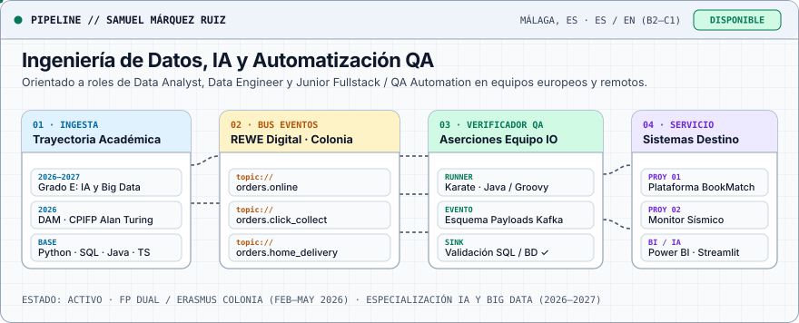
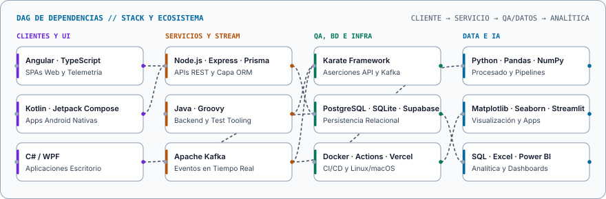
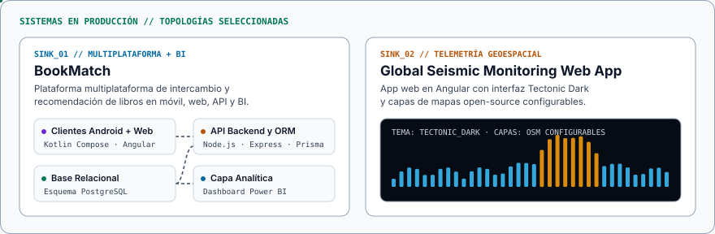

<p align="right">
  <a href="./README.md">EN</a> | <strong>ES</strong>
</p>

<picture>
  <source media="(prefers-color-scheme: dark)" srcset="./assets/hero-dark-es.svg">
  <source media="(prefers-color-scheme: light)" srcset="./assets/hero-light-es.svg">
  
</picture>

### `01 // PROCESAMIENTO DE STREAMS Y VERIFICACIÓN QA`

Desarrollo pipelines de datos, aplicaciones multiplataforma y suites automatizadas que verifican sistemas distribuidos bajo carga real de eventos. Con base en **Málaga, España** (Español nativo, Inglés B2/C1).

| Etapa                          | Contexto                                                        | Implementación                                                                                                                        |
| :----------------------------- | :-------------------------------------------------------------- | :------------------------------------------------------------------------------------------------------------------------------------ |
| **Experiencia Internacional**  | **REWE Digital — Equipo IO** (Colonia, Alemania · Feb–May 2026) | FP Dual / Erasmus en backend y automatización QA para flujos de pedidos online, Click & Collect y entrega a domicilio                 |
| **Validación de Eventos y BD** | Streams en tiempo real                                          | Validación de payloads en **Apache Kafka** y aserciones sobre estado en base de datos con **Karate Framework**, **Java** y **Groovy** |
| **Especialización Actual**     | **IA y Big Data (Grado E)** · 2026–2027                         | Ampliando la base de ingeniería hacia pipelines analíticos, flujos de machine learning y procesamiento masivo de datos                |
| **Titulación Principal**       | **DAM (Técnico Superior)** · CPIFP Alan Turing (Málaga, 2026)   | Arquitectura de aplicaciones multiplataforma en móvil, web, bases de datos relacionales y servicios backend                           |

---

### `02 // DAG DE DEPENDENCIAS — STACK TÉCNICO`

<picture>
  <source media="(prefers-color-scheme: dark)" srcset="./assets/stack-dag-dark-es.svg">
  <source media="(prefers-color-scheme: light)" srcset="./assets/stack-dag-light-es.svg">
  
</picture>

<details>
  <summary><code>Ver inventario completo por capa</code></summary>

- **Data e IA:** `Python` (`Pandas`, `NumPy`, `Matplotlib`, `Seaborn`, `Streamlit`), `SQL`, `Excel`, `Power BI`
- **Backend, Mensajería y QA:** `Node.js` (`Express`, `Prisma`), `Java`, `Groovy`, `Apache Kafka`, `Karate Framework`, `PostgreSQL`, `SQLite`, `Supabase`
- **Frontend y Móvil:** `Angular`, `TypeScript`, `Kotlin`, `Jetpack Compose`, `C# / WPF`
- **Workflow e Infraestructura:** `Git`, `GitHub Actions`, `Docker`, `Vercel`, `Linux / macOS`

</details>

---

### `03 // SISTEMAS EN PRODUCCIÓN`

<picture>
  <source media="(prefers-color-scheme: dark)" srcset="./assets/projects-dark-es.svg">
  <source media="(prefers-color-scheme: light)" srcset="./assets/projects-light-es.svg">
  
</picture>

| Sistema                                           | Repositorio                                                                                                                                              | Stack                                                                            |
| :------------------------------------------------ | :------------------------------------------------------------------------------------------------------------------------------------------------------- | :------------------------------------------------------------------------------- |
| **`SINK_01` · BookMatch**                         | [Web & API](https://github.com/Sergiibut05/BookMatch-Proyecto-Intermodular) · [Android (Kotlin)](https://github.com/SamuelMarquezRuiz/BookMatch-Android) | `Kotlin` · `Jetpack Compose` · `Angular` · `Node.js` · `Prisma` · `PostgreSQL` · `Power BI` |
| **`SINK_02` · Global Seismic Monitoring Web App** | [SamuelMarquezRuiz/observatorio-sismico](https://github.com/SamuelMarquezRuiz/observatorio-sismico)                                                      | `Angular` · `TypeScript` · `Tectonic Dark UI` · `Capas de Mapas Open-Source`     |

---

### `04 // ENDPOINTS`

```text
GET   github.com/SamuelMarquezRuiz                         -> Repositorios y código fuente
GET   linkedin.com/in/samuel-márquez-ruiz-a21914311        -> Experiencia y trayectoria internacional
GET   ./docs/CV.pdf                                        -> Currículum Vitae (PDF)
MAIL  samuelmarquez588@gmail.com                           -> Consultas Data / Fullstack / QA
```

[Abrir GitHub](https://github.com/SamuelMarquezRuiz) · [Abrir LinkedIn](https://www.linkedin.com/in/samuel-m%C3%A1rquez-ruiz-a21914311) · [Descargar CV](./docs/CV.pdf) · [Enviar Email](mailto:samuelmarquez588@gmail.com)
