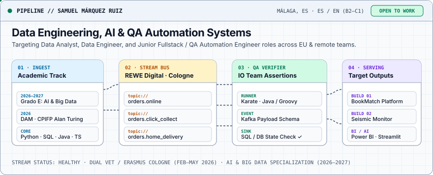
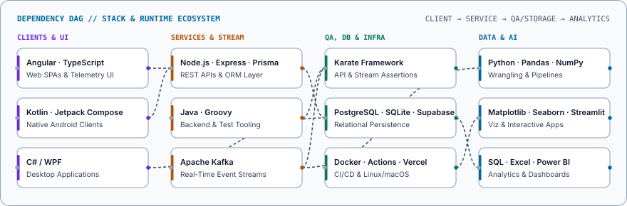
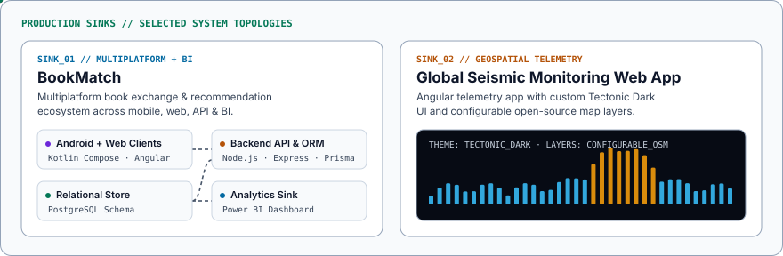

<p align="right">
  <strong>EN</strong> | <a href="./README.es.md">ES</a>
</p>

<picture>
  <source media="(prefers-color-scheme: dark)" srcset="./assets/hero-dark.svg">
  <source media="(prefers-color-scheme: light)" srcset="./assets/hero-light.svg">
  
</picture>

### `01 // STREAM PROCESSING & QA VERIFICATION`

I build data pipelines, multiplatform applications, and automated test harnesses that verify distributed systems under real event loads. Based in **Málaga, Spain** (Spanish native, English B2/C1).

| Stage                      | Context                                                        | Implementation                                                                                                                |
| :------------------------- | :------------------------------------------------------------- | :---------------------------------------------------------------------------------------------------------------------------- |
| **Production Internship**  | **REWE Digital — IO Team** (Cologne, Germany · Feb–May 2026)   | Dual VET / Erasmus backend & QA automation across online orders, Click & Collect, and home delivery flows                     |
| **Event & DB Validation**  | Real-time fulfillment streams                                  | Validated **Apache Kafka** event payloads and database state transitions using **Karate Framework**, **Java**, and **Groovy** |
| **Current Specialization** | **AI & Big Data (Grado E)** · 2026–2027                        | Extending software foundations into analytical pipelines, machine learning workflows, and large-scale data processing         |
| **Core Degree**            | **DAM (Higher Technician)** · CPIFP Alan Turing (Málaga, 2026) | Multiplatform application architecture across mobile, web, relational databases, and backend services                         |

---

### `02 // DEPENDENCY DAG — TECH STACK`

<picture>
  <source media="(prefers-color-scheme: dark)" srcset="./assets/stack-dag-dark.svg">
  <source media="(prefers-color-scheme: light)" srcset="./assets/stack-dag-light.svg">
  
</picture>

<details>
  <summary><code>Inspect full runtime inventory by layer</code></summary>

- **Data & AI:** `Python` (`Pandas`, `NumPy`, `Matplotlib`, `Seaborn`, `Streamlit`), `SQL`, `Excel`, `Power BI`
- **Backend, Messaging & QA:** `Node.js` (`Express`, `Prisma`), `Java`, `Groovy`, `Apache Kafka`, `Karate Framework`, `PostgreSQL`, `SQLite`, `Supabase`
- **Frontend & Mobile:** `Angular`, `TypeScript`, `Kotlin`, `Jetpack Compose`, `C# / WPF`
- **Workflow & Infra:** `Git`, `GitHub Actions`, `Docker`, `Vercel`, `Linux / macOS`

</details>

---

### `03 // PRODUCTION SINKS`

<picture>
  <source media="(prefers-color-scheme: dark)" srcset="./assets/projects-dark.svg">
  <source media="(prefers-color-scheme: light)" srcset="./assets/projects-light.svg">
  
</picture>

| Sink                                              | Repository                                                                                                                                               | Stack                                                                                       |
| :------------------------------------------------ | :------------------------------------------------------------------------------------------------------------------------------------------------------- | :------------------------------------------------------------------------------------------ |
| **`SINK_01` · BookMatch**                         | [Web & API](https://github.com/Sergiibut05/BookMatch-Proyecto-Intermodular) · [Android (Kotlin)](https://github.com/SamuelMarquezRuiz/BookMatch-Android) | `Kotlin` · `Jetpack Compose` · `Angular` · `Node.js` · `Prisma` · `PostgreSQL` · `Power BI` |
| **`SINK_02` · Global Seismic Monitoring Web App** | [SamuelMarquezRuiz/observatorio-sismico](https://github.com/SamuelMarquezRuiz/observatorio-sismico)                                                      | `Angular` · `TypeScript` · `Tectonic Dark UI` · `Open-Source Map Layers`                    |

---

### `04 // ENDPOINTS`

```text
GET   github.com/SamuelMarquezRuiz                         -> Source repositories & workflows
GET   linkedin.com/in/samuel-márquez-ruiz-a21914311        -> Experience & international track
GET   ./docs/CV.pdf                                        -> Curriculum Vitae (PDF)
MAIL  samuelmarquez588@gmail.com                           -> Data / Fullstack / QA inquiries
```

[Open GitHub](https://github.com/SamuelMarquezRuiz) · [Open LinkedIn](https://www.linkedin.com/in/samuel-m%C3%A1rquez-ruiz-a21914311) · [Download CV](./docs/CV.pdf) · [Send Email](mailto:samuelmarquez588@gmail.com)
